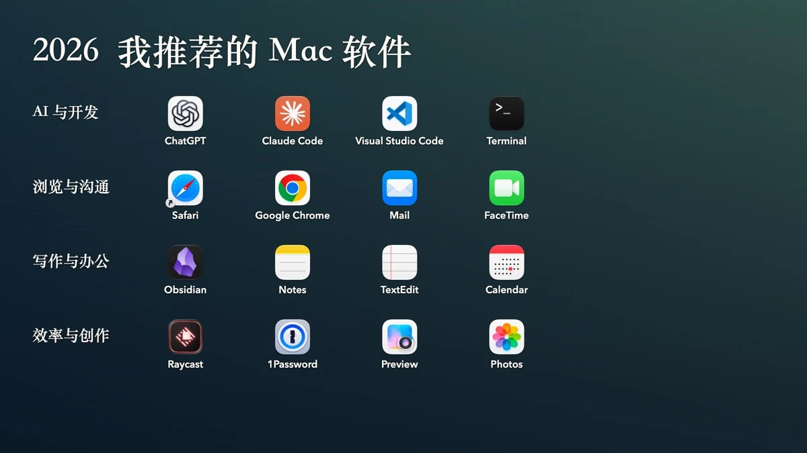
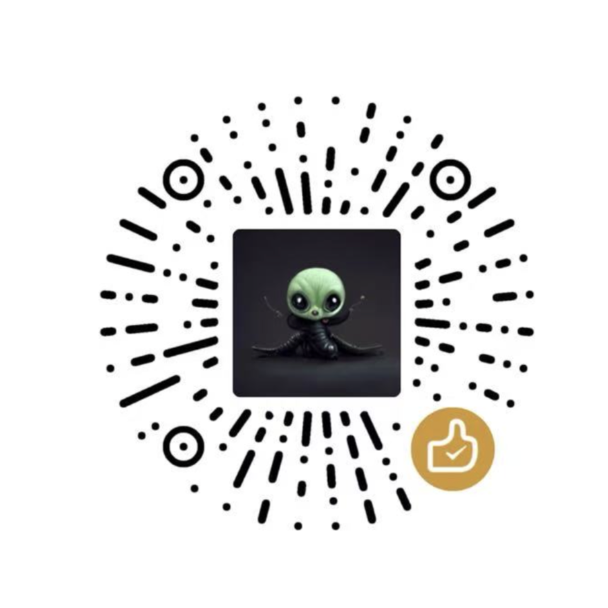

# Mac 软件推荐海报

把正在用的 Mac 应用、它们的原生图标和你的桌面背景，变成一张可分享的海报。助手根据本机可见的使用日期提议候选，你挑选自己愿意推荐的软件。



## 安装

需要在 Mac 本机的桌面会话运行，需有 Node.js 20 或更新版本。适用于支持 Agent Skills 且能运行本机命令的助手。

```bash
npx skills add joeseesun/qiaomu-mac-software --skill qiaomu-mac-software
```

安装后你可以直接这样说。

- “扫一下我 Mac 最近六个月常用的软件，用当前壁纸做一张推荐海报。”
- “先给我看候选。把 Claude Code 加上，去掉不想推荐的，再让我预览。”
- “Raycast 的理由写：一个快捷键搞定剪贴板和窗口。”
- “用‘小乔’署名，只生成分享链接。” 你也可以选择出现在公开画廊。

## 制作和分享

1. 扫描系统和用户的常规应用目录，合并重复安装并按可见使用日期排序。
2. 运行 `pick` 打开本机挑选页，看着真实图标勾选软件、改分类、写推荐理由；也可以在助手的询问组件里选择，没有该组件的助手可以用聊天来选。
3. 可选：给喜欢的几款软件各写一句推荐理由（60 字以内），再定一个署名。理由会显示在网站的软件页上。
4. 在本机用真实应用图标和壁纸生成宽 2400 像素的 PNG，底部印署名和网址。可改用本机图片或纯色。
5. 成图预览后，自选只保存、仅链接或公开到[乔木软件推荐](https://software.qiaomu.ai)。公开海报会给里面每款软件在软件榜上投一票。分享名可以是昵称，撤回凭证存在本机。

Spotlight 的范围取决于这台 Mac 能提供的记录。候选反映过去六个月窗口内的**可见活跃天数**，实际记录可能更短。未记录的应用也可以手选。应用安装路径、时间和原始壁纸文件留在本机。分享时上传成图、选中软件的名称、分类、推荐理由、应用 ID 和 128px 图标；网站已有的图标只发指纹，不重复上传。成图会包含壁纸，请在分享前看一眼。只做本地海报不需要访问网站。

## 常见问题 (Troubleshooting)

遇到应用装在其他目录、系统壁纸不可读或想手动运行脚本，可查看[工作流与边界](references/workflow.md)。

## 本地验证

在 macOS 上可先运行 `node --check scripts/macos.mjs`，再执行 `node scripts/macos.mjs scan --dir "$(mktemp -d)"`。维护者可用乔木 meta skill 的 `validate_skill.py` 复核文档、版本与证据。

网站源码：[qiaomu-software](https://github.com/joeseesun/qiaomu-software)。本技能采用 MIT 许可，示例中的软件图标属于各自权利人。

<!-- qiaomu-profile:start -->
## 关于向阳乔木

向阳乔木（乔向阳 / Joe）是一位实践型 AI 产品与内容创作者，长期把前沿 AI 变化转译成可复用的工作流、产品判断、AI 编程实践、AI 搜索实践和 GEO/AI 营销方法。

- 个人网站: https://qiaomu.ai
- 博客: https://blog.qiaomu.ai
- X: https://x.com/vista8
- GitHub: https://github.com/joeseesun/
- 微信公众号: 向阳乔木推荐看

### 支持与关注

| 打赏支持 | 微信公众号 |
|---|---|
|  |  |
| 感谢支持乔木持续分享 AI 实践 | 扫码关注「向阳乔木推荐看」 |

<!-- qiaomu-profile:end -->

